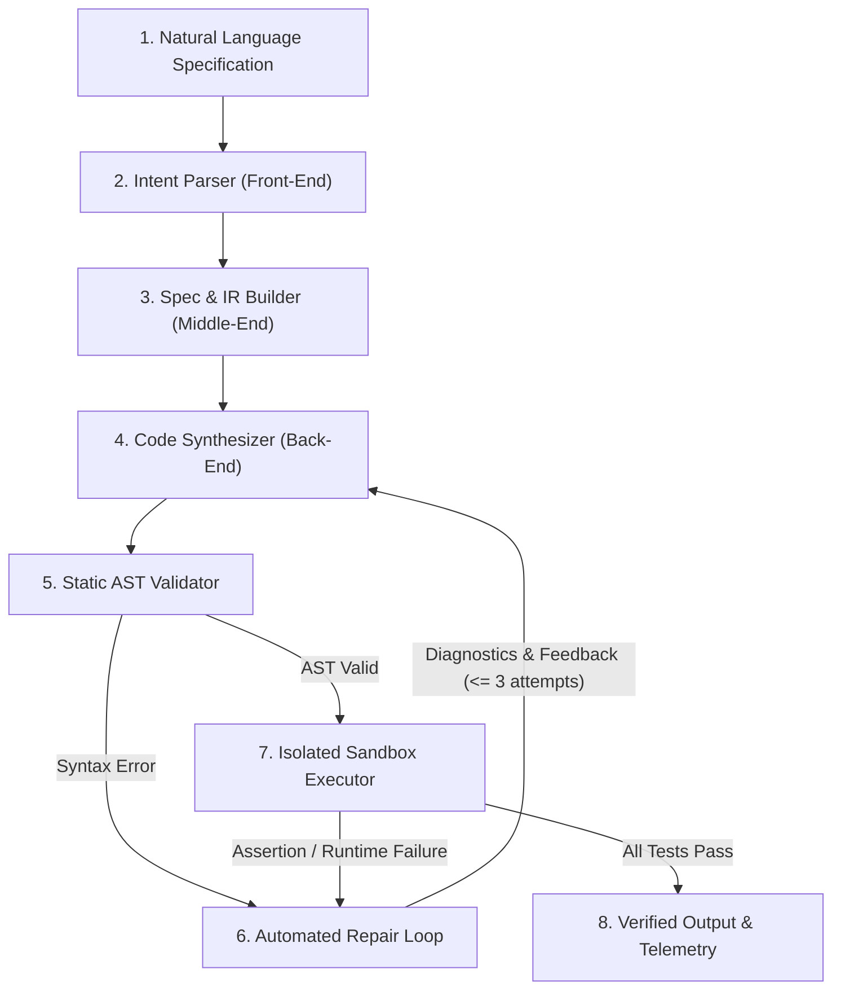

# Natural Language-to-Code Compiler (NL2Code)

A multi-stage, compiler-grade system that parses natural language specifications, translates them into a strongly typed Intermediate Representation (IR), synthesizes target code across multiple programming languages, validates abstract syntax trees, executes unit tests within an isolated sandbox, and automatically repairs failures via an iterative diagnostic feedback loop.

---

## 1. Compiler Architecture

Unlike trivial single-shot LLM wrappers, **NL2Code** models program generation as an end-to-end multi-phase compiler pipeline:



### Compiler Phases

1. **Intent Parser (Front-End)**: Performs lexical and semantic extraction from unstructured English. Extracts task objectives, variable types, mathematical bounds, and edge cases.
2. **Intermediate Representation Builder (Middle-End)**: Compiles intent into a strict, validated Pydantic JSON IR (`function_name`, `signature`, `inputs[]`, `outputs`, `constraints[]`, `edge_cases[]`, `complexity_target`, `test_cases[]`).
3. **Code Synthesizer (Back-End)**: Synthesizes idiomatic target code for Python, C++, Java, or JavaScript using pluggable LLM providers (Gemini, OpenAI, Anthropic, or deterministic Mock).
4. **Static AST Validator**: Performs lexical grammar checks, bracket balance analysis, and native AST parsing (`ast.parse` for Python, `node --check` for JS, `g++ -fsyntax-only` for C++, `javac` for Java), rejecting malicious system calls.
5. **Sandbox Executor (Runtime)**: Executes generated code against synthesized unit test suites in an isolated Docker container or isolated subprocess with zero network access, memory caps, CPU limits, and strict 5-second timeouts.
6. **Self-Repair Loop (Diagnostics & Recovery)**: Upon syntax errors or failed test assertions, compiler diagnostics and failing inputs are fed back into the synthesis engine to regenerate corrected code (up to 3 iterations).

---

## 2. Supported Target Languages

| Language | Adapter | AST / Syntax Validation | Test Harness Execution |
| :--- | :--- | :--- | :--- |
| **Python** | `PythonAdapter` | `ast.parse` | Native dynamic evaluation |
| **C++** | `CppAdapter` | `g++ -fsyntax-only` / AST balance | `g++ -O2 -std=c++17` runner |
| **Java** | `JavaAdapter` | `javac` / structural balance | `javac` + `java Solution` runner |
| **JavaScript** | `JavaScriptAdapter` | `node --check` | `node` with `assert.deepStrictEqual` |

---

## 3. Tech Stack

- **Backend**: Python 3.11+, FastAPI, Pydantic v2, SQLAlchemy, SQLite, Docker SDK, SSE-Starlette
- **Frontend**: React 18, Vite, TypeScript, Tailwind CSS, Monaco Editor, Lucide Icons
- **Infrastructure**: Docker, Docker Compose, GitHub Actions CI
- **Testing**: Pytest, TestClient

---

## 4. Setup & Running Instructions

### Option A: Local Development (Recommended for quick evaluation)

#### 1. Backend Setup:
```bash
cd nl2code/backend
pip install -r requirements.txt
python -m uvicorn app.main:app --host 127.0.0.1 --port 8000 --reload
```
The backend API is now running at `http://127.0.0.1:8000`. Swagger documentation is accessible at `http://127.0.0.1:8000/docs`.

#### 2. Frontend Setup:
```bash
cd nl2code/frontend
npm install
npm run dev
```
The compiler UI is now accessible at `http://localhost:5173`.

---

### Option B: Docker Compose Deployment

Run the complete multi-service stack with a single command:
```bash
cd nl2code
docker-compose up --build
```
- Frontend UI: `http://localhost:5173`
- Backend API: `http://localhost:8000`

---

## 5. Running Tests and CI Validation

Run all unit and integration test suites:
```bash
cd nl2code
python -m pytest backend/tests/ -v
```

Run frontend production bundle validation:
```bash
cd nl2code/frontend
npm run build
```

---

## 6. Example Prompts & Verified Outputs

### 1. Top K Frequent Elements (Target: Python)
- **Input Prompt**: `"Write a function that returns the k most frequent elements in an array"`
- **Generated IR**:
  ```json
  {
    "function_name": "top_k_frequent",
    "signature": "def top_k_frequent(nums: list, k: int) -> list:",
    "complexity_target": { "time_complexity": "O(n log k)", "space_complexity": "O(n)" },
    "test_cases": [
      { "id": 1, "input_args": { "nums": [1, 1, 1, 2, 2, 3], "k": 2 }, "expected_output": [1, 2] }
    ]
  }
  ```
- **Generated Code**:
  ```python
  from collections import Counter

  def top_k_frequent(nums: list, k: int) -> list:
      count = Counter(nums)
      return [item for item, _ in count.most_common(k)]
  ```
- **Result**: PASSED 3/3 Unit Tests in 74 ms.

### 2. Valid Palindrome (Target: C++)
- **Input Prompt**: `"Check if a string is a valid palindrome ignoring punctuation and case"`
- **Generated Code**:
  ```cpp
  bool is_palindrome(std::string s) {
      int left = 0, right = s.length() - 1;
      while (left < right) {
          while (left < right && !std::isalnum(s[left])) left++;
          while (left < right && !std::isalnum(s[right])) right--;
          if (std::tolower(s[left]) != std::tolower(s[right])) return false;
          left++; right--;
      }
      return true;
  }
  ```
- **Result**: PASSED 3/3 Unit Tests.

### 3. Merge Overlapping Intervals (Target: Java)
- **Input Prompt**: `"Merge overlapping intervals"`
- **Result**: PASSED 2/2 Unit Tests.

### 4. Debounce Function (Target: JavaScript)
- **Input Prompt**: `"Debounce a function by N milliseconds"`
- **Result**: PASSED 2/2 Unit Tests.

---

## 7. Complexity & Scalability Notes

- **Time Complexity Enforcement**: The compiler pipeline synthesizes theoretical complexity metrics ($O(n \log k)$, $O(n)$, etc.) directly into the IR metadata.
- **Asynchronous Event Streaming**: High throughput is achieved using Server-Sent Events (SSE) backed by asyncio event queues, keeping clients continuously updated without polling.
- **Defensive Sandbox Constraints**: Subprocess / Docker runners enforce non-root permissions, memory caps (256 MB), and strict timeouts to defend against infinite loops and fork bombs.
